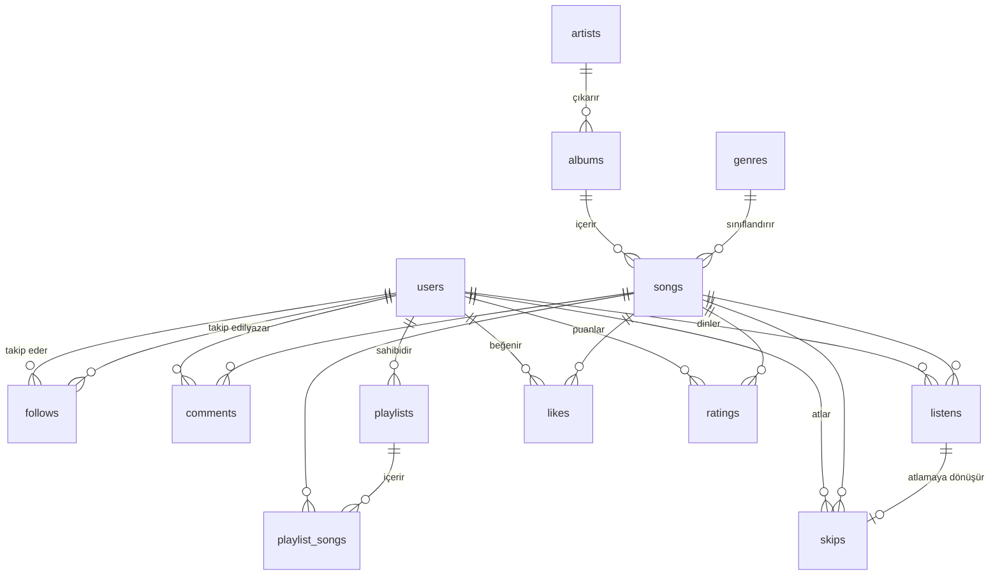

# Müzik Öneri Sistemi

**Kullanıcı Etkileşim Verisine Dayalı Sosyal Müzik Öneri ve Analitik Sistemi**


Dinleme, beğeni, puanlama, atlama ve takip verilerini ilişkisel bir modelde tutan; bu veriler üzerinden kişiselleştirilmiş şarkı önerileri ve dinleme analitiği üreten bir Microsoft SQL Server veritabanı projesi. Üç farklı öneri yöntemi ayrı ayrı geliştirilir ve ağırlıklı bir hibrit modelde birleştirilir.

Veritabanı Sistemleri dersi kapsamında geliştirilmiştir.

## Özellikler

| Özellik | Açıklama | Nesne |
| --- | --- | --- |
| Sosyal öneri | Takip edilen kullanıcıların dinledikleri şarkılar | `rec_social` |
| İçerik tabanlı öneri | Kullanıcının sık dinlediği türlere benzer şarkılar | `rec_content` |
| İşbirlikçi filtreleme | Benzer zevkteki kullanıcıların dinledikleri | `rec_collaborative` |
| Hibrit öneri | Üç yöntemin ağırlıklı birleşimi (sosyal 0,3 · içerik 0,3 · işbirlikçi 0,4) | `get_recommendations` |
| Yıllık özet | Kullanıcının yıl içindeki dinleme istatistikleri | `yearly_wrapped` |
| Trend analizi | Son 14 günde öne çıkan şarkılar | `trending_songs` |
| Otomatik atlama tespiti | 30 saniyeden kısa dinlemelerin atlama olarak kaydedilmesi | `trg_auto_skip` |
| Transaction ile liste oluşturma | Çalma listesi ve şarkılarının tek işlemde eklenmesi | `create_playlist_with_songs` |

## Veritabanı Şeması

Sistem üç modülde toplam 13 tablodan oluşur.



| Modül | Tablolar |
| --- | --- |
| Kullanıcı ve sosyal | `users`, `follows`, `comments` |
| Katalog ve çalma listeleri | `genres`, `artists`, `albums`, `songs`, `playlists`, `playlist_songs` |
| Etkileşim ve analitik | `listens`, `likes`, `ratings`, `skips` |

Tablo ve sütun adları, veri tipleri, silme kuralları ve nesne adları [`ortak_sema_sozlesmesi.md`](ortak_sema_sozlesmesi.md) belgesinde tanımlıdır. Belge ile kod arasında bir çelişki olursa belge esas alınır.

## Proje Yapısı

```
muzik-oneri-sistemi/
├── sql/
│   ├── 01_users.sql               # users, follows
│   ├── 02_catalog.sql             # genres, artists, albums, songs, playlists, playlist_songs
│   ├── 03_interactions.sql        # listens, likes, ratings, skips
│   ├── 04_comments.sql            # comments
│   ├── 05_advanced_a.sql          # Kullanıcı modülü: view, trigger, procedure, index, öneri
│   ├── 05_advanced_b.sql          # Katalog modülü: procedure, transaction, index, öneri
│   ├── 05_advanced_c.sql          # Etkileşim modülü: trigger, view, index, öneri
│   ├── 06_recommendations.sql     # Hibrit öneri
│   └── queries/
│       ├── users_queries.sql
│       ├── catalog_queries.sql
│       └── interactions_queries.sql
├── data/                          # Veri dosyaları
├── rapor/                         # Proje raporu
├── sunum/                         # Sunum dosyaları
└── ortak_sema_sozlesmesi.md       # Ortak şema sözleşmesi
```

### Dosya durumu

| Dosya | Sorumlu | Durum |
| --- | --- | --- |
| `sql/01_users.sql` | Şeyma | Geliştiriliyor |
| `sql/02_catalog.sql` | Beyza | Tamamlandı |
| `sql/03_interactions.sql` | Sema | Geliştiriliyor |
| `sql/04_comments.sql` | Şeyma | Geliştiriliyor |
| `sql/05_advanced_a.sql` | Şeyma | Geliştiriliyor |
| `sql/05_advanced_b.sql` | Beyza | Geliştiriliyor |
| `sql/05_advanced_c.sql` | Sema | Geliştiriliyor |
| `sql/06_recommendations.sql` | Ortak | Geliştiriliyor |
| `sql/queries/users_queries.sql` | Şeyma | Geliştiriliyor |
| `sql/queries/catalog_queries.sql` | Beyza | Geliştiriliyor |
| `sql/queries/interactions_queries.sql` | Sema | Geliştiriliyor |

## Kurulum

### Gereksinimler

- Microsoft SQL Server 2019 veya üstü (Express sürümü yeterlidir)
- SQL Server Management Studio (SSMS)

### Adımlar

1. Depoyu klonlayın:

   ```bash
   git clone https://github.com/Muzik-Oneri-Sistemi/muzik-oneri-sistemi.git
   ```

2. Veritabanını Türkçe sıralamayla oluşturun:

   ```sql
   CREATE DATABASE muzik_db COLLATE Turkish_CI_AS;
   ```

3. `sql/` klasöründeki betikleri SSMS'te aşağıdaki sırayla çalıştırın. Sıra, yabancı anahtar bağımlılıklarına göre belirlenmiştir.

   | Sıra | Dosya | İçerik |
   | --- | --- | --- |
   | 1 | `01_users.sql` | `users`, `follows` |
   | 2 | `02_catalog.sql` | `genres`, `artists`, `albums`, `songs`, `playlists`, `playlist_songs` |
   | 3 | `03_interactions.sql` | `listens`, `likes`, `ratings`, `skips` |
   | 4 | `04_comments.sql` | `comments` |
   | 5 | `05_advanced_a.sql`, `05_advanced_b.sql`, `05_advanced_c.sql` | View, trigger, procedure, index ve öneri fonksiyonları |
   | 6 | `06_recommendations.sql` | `get_recommendations` |

4. Örnek sorgular için `sql/queries/` klasöründeki dosyaları çalıştırın.

## Katkı Kuralları

- Her ekip üyesi yalnızca kendi sorumlu olduğu dosyaları değiştirir.
- Yüklenen her betik, boş bir veritabanında hatasız çalıştırılarak test edilmiş olmalıdır.
- Çalışmaya başlamadan önce depo güncellenir (`git pull`).
- Commit mesajları modül etiketiyle başlar: `[A]`, `[B]` veya `[C]`.
  Örnek: `[C] listens tablosuna örnek veri eklendi`
- Geçici test dosyaları (`gecici_*.sql`) depoya eklenmez.
- Tüm çalışmalar doğrudan `main` dalında yürütülür.
- Ortak sözleşmedeki bir ismin değişmesi için önce ekipte onay alınır, ardından sözleşme güncellenir.

### Geliştirme ortamı

İlk kurulumda Git kimliğinizi tanımlayın:

```bash
git config --global user.name "github-kullanici-adiniz"
git config --global user.email "github-hesabinizdaki-eposta"
git config --global pull.rebase false
```

Günlük çalışma akışı:

```bash
git pull                                   # Son değişiklikleri al
git add sql/03_interactions.sql            # Yalnızca kendi dosyanı ekle
git commit -m "[C] listens tablosu eklendi"
git push                                   # GitHub'a gönder
```

`git push` reddedilirse önce `git pull`, ardından tekrar `git push` çalıştırın.

## Ekip

| Üye | Modül | Sorumlu olduğu tablolar |
| --- | --- | --- |
| Şeyma (A) | Kullanıcı ve sosyal modül, yıllık özet, sosyal öneri | `users`, `follows`, `comments` |
| Beyza (B) | Katalog ve çalma listeleri, içerik tabanlı öneri, transaction | `genres`, `artists`, `albums`, `songs`, `playlists`, `playlist_songs` |
| Sema (C) | Etkileşim ve analitik, işbirlikçi filtreleme, trend analizi | `listens`, `likes`, `ratings`, `skips` |
